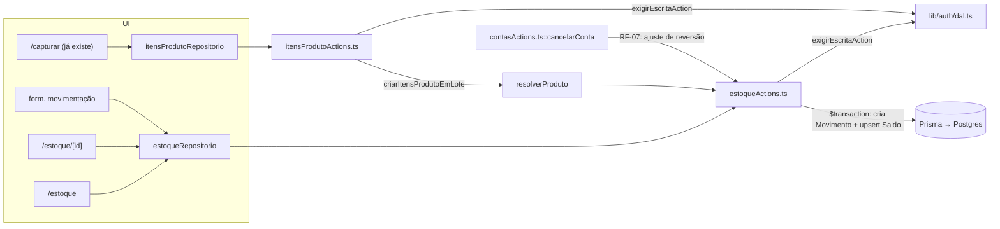

# PRD — Estoque

> Status: pronto para execução · Data: 2026-09-23 · Depende de: `docs/prd/multiempresa-login-trial.md` (Fases 1-4, já implementadas e commitadas)

## 1. Resumo

**Problema:** o app não tem noção de estoque. `ItemProduto` é só o registro de compra dentro de uma `ContaFinanceira` (obrigatoriamente ligado a conta + obra), sem conceito de saldo disponível — a única forma de "consultar produto" hoje é `/custos-produtos`, uma busca de histórico de preço por texto livre (`normalizarDescricao`), sem catálogo formal. A empresa não sabe quanto tem de cada material, em qual obra, nem é avisada quando algo está acabando.

**Solução:** um catálogo de produtos por empresa, com saldo calculado por combinação produto + obra (multi-local, já que obra é o único conceito de "lugar" que o app tem), movimentação manual (entrada/saída/ajuste) e alerta de estoque mínimo. A captura de nota fiscal por câmera (já existente, via IA) passa a alimentar o estoque automaticamente: cada item extraído resolve ou cria um produto do catálogo e gera uma entrada, do mesmo jeito que já resolve/cria um `Fornecedor` hoje.

**Por que agora:** é a próxima fase do plano acordado depois da fundação de auth/multiempresa; sem estoque, a captura por IA já lançada continua só alimentando o financeiro, sem o outro lado (quanto material isso representa) — que é metade do valor da funcionalidade.

## 2. Usuários e contexto de uso

Mesmo público do PRD anterior (dono/sócio de construtora PJ, autônomo PF, financeiro/assistente). Uso: consulta de saldo antes de comprar de novo, lançamento de saída ao consumir material na obra, ajuste depois de contagem física. Frequência baixa a média (não é operação diária de e-commerce; é controle de obra).

## 3. Escopo

**Dentro:**
- Catálogo de produtos por empresa (`Produto`): nome, SKU opcional, categoria, unidade, custo médio, estoque mínimo.
- Saldo por produto **e por obra** (`SaldoEstoque`), materializado — não somado em runtime.
- Movimentação manual de estoque: entrada, saída, ajuste (`MovimentoEstoque`), sempre vinculada a uma obra.
- Listagem de produtos com saldo total (soma de todas as obras) e alerta visual quando abaixo do mínimo.
- Ficha do produto: saldo por obra + histórico de movimentos.
- Integração automática: todo `ItemProduto` criado pela captura por IA (`criarItensProdutoEmLote`, hoje só chamado por `/capturar`) resolve/cria um `Produto` pela descrição e gera uma entrada de estoque — mesmo padrão de `resolverFornecedor`.
- Reversão de estoque ao cancelar uma conta que originou itens (RF-07), sem bloquear o cancelamento se o material já foi consumido.
- Isolamento por `empresaId`, `exigirEscritaAction()` em toda escrita, mesmo padrão das 7 tabelas existentes.

**Fora (fases futuras):**
- Custo médio ponderado sofisticado / FIFO — nesta fase o custo médio é uma média ponderada simples, recalculada a cada entrada.
- Depósito como conceito separado de obra — quem precisar de um "estoque não alocado" cria uma Obra para isso (ex.: "Almoxarifado central"), reaproveitando o cadastro que já existe.
- Estoque mínimo por obra (nesta fase é uma propriedade do produto, não por local).
- Transferência de estoque entre obras como operação única (nesta fase é manual: uma saída na obra A + uma entrada na obra B).
- Código de barras/scanner, fusão de produtos duplicados no catálogo, inativação/exclusão de produto.
- Fluxo completo de nota fiscal com estados processando/revisão/confirmada/erro — isso é a Fase 6 (Notas com IA), fora deste PRD; aqui a IA continua exatamente como está, só o que ela já extrai passa a também alimentar o estoque.

## 4. Requisitos funcionais

| ID | Requisito (dado / quando / então) | Prioridade |
|---|---|---|
| RF-01 | **Dado** um nome preenchido em `/estoque/novo`, **então** o produto é criado com SKU/categoria/unidade/estoque mínimo/observação opcionais. SKU, quando informado, é único por empresa (`@@unique([empresaId, sku])` — múltiplos produtos sem SKU coexistem normalmente, `NULL` não conflita entre si no Postgres). | Must |
| RF-02 | `/estoque` lista produtos com o saldo total (soma de `SaldoEstoque` de todas as obras) e um selo de alerta quando o saldo total é menor que `estoqueMinimo` (quando definido). | Must |
| RF-03 | `/estoque/[id]` mostra a ficha do produto, o saldo por obra (`SaldoEstoque` daquele produto) e o histórico de movimentos (mais recente primeiro), com o tipo, quantidade, obra, origem ("manual" ou "item de nota fiscal") e quem lançou. | Must |
| RF-04 | Formulário de movimentação manual (produto, obra, tipo, quantidade, valor unitário opcional, observação). **Entrada** soma ao saldo da obra; **saída** exige saldo suficiente na obra (senão erro "Saldo insuficiente nesta obra: restam X"); **ajuste** pede a quantidade final desejada, e o sistema calcula a diferença internamente (nunca aceita um delta livre, para não deixar o saldo negativo por digitação). | Must |
| RF-05 | Toda escrita (`criarProduto`, `registrarMovimento`) passa por `exigirEscritaAction()` — bloqueada em modo somente-leitura, igual ao resto do app. Toda leitura/escrita usa `empresaId` da sessão, nas 3 tabelas novas. | Must |
| RF-06 | **Quando** `criarItensProdutoEmLote` roda (hoje só a partir de `/capturar`), **então**, para cada item, o sistema resolve um `Produto` existente pela descrição normalizada (`normalizarDescricao`, já usado em `historicoPrecoPorDescricao`) ou cria um novo (`resolverProduto`, mesmo padrão de `resolverFornecedor`), e gera uma entrada de estoque na obra do item, com `origem = "item_produto"` e `itemProdutoId` apontando para o item. | Must |
| RF-07 | **Quando** uma conta é cancelada (`cancelarConta`) e tem itens com entrada de estoque de origem `item_produto`, **então** o sistema tenta gerar um ajuste (saída) revertendo a quantidade. **Se** isso deixaria o saldo negativo na obra (material já consumido), **então** o cancelamento da conta continua normalmente, sem reverter o estoque, e a UI mostra "Estoque já consumido nesta obra — ajuste manual necessário" — nunca bloqueia o cancelamento por causa do estoque. | Should |
| RF-08 | O custo médio do produto (`Produto.custoMedio`) é recalculado a cada entrada como média ponderada pela quantidade (`(custoAtual × saldoAtual + valorUnitarioNovo × quantidadeNova) / (saldoAtual + quantidadeNova)`), guardado no próprio produto — não é recalculado em saída/ajuste. | Should |
| RF-09 | O saldo (`SaldoEstoque.quantidade`) nunca é lido por soma de movimentos em runtime — é uma linha materializada por `(produtoId, obraId)`, atualizada atomicamente (`upsert` com `increment`) na mesma transação que cria o `MovimentoEstoque`. | Must |

## 5. Requisitos não funcionais

- **Consistência:** criar um movimento e atualizar o saldo correspondente sempre na mesma `$transaction` do Prisma — nunca em duas chamadas separadas (janela de inconsistência se a segunda falhar).
- **Concorrência:** o `upsert` de `SaldoEstoque` usa o índice único `(produtoId, obraId)` para ser atômico (mesmo princípio do `INSERT ... ON CONFLICT` já usado em `LimiteTaxa`, ver `src/lib/auth/limite.ts`) — duas movimentações concorrentes no mesmo produto/obra não perdem incremento.
- **Desempenho:** listagem de `/estoque` não deve fazer uma query por produto — uma única consulta agrupando `SaldoEstoque` por `produtoId` (`groupBy`/`sum` do Prisma é aceitável aqui porque é uma leitura agregada única, não um cálculo de saldo repetido em cada request de escrita).
- **Compatibilidade:** datas/timestamps como `String` ISO, igual ao resto do schema (ver comentário no topo de `prisma/schema.prisma`).

## 6. Arquitetura



**Camadas (seguindo o padrão já usado nas actions existentes, ver `obrasActions.ts`/`fornecedoresActions.ts`):**
- `src/services/data/server/estoqueActions.ts` (novo): `criarProduto`, `listarProdutos` (com saldo total agregado), `obterProdutoPorId` (com saldos por obra + histórico), `registrarMovimento`, `resolverProduto` (interno, chamado por `itensProdutoActions.ts`).
- `src/services/data/server/itensProdutoActions.ts` (editado): `criarItensProdutoEmLote` passa a chamar `resolverProduto` + `registrarMovimento` por item, na mesma transação que já cria os `ItemProduto`.
- `src/services/data/server/contasActions.ts` (editado): `cancelarConta` ganha o passo do RF-07 (best-effort, não lança erro se não conseguir reverter).
- `src/lib/validacao/estoque.ts` (novo): `novoProdutoSchema`, `movimentoEstoqueSchema` — zod `.strict()`, mesmo padrão de `src/lib/validacao/contas.ts`.
- `src/types/produto.ts`, `src/types/movimentoEstoque.ts` (novos): `NovoProdutoInput`, `NovoMovimentoInput`, `Produto`, `MovimentoEstoque`, `SaldoPorObra` — adicionar contratos em `src/services/data/repositorios.ts`.
- `src/app/(app)/estoque/page.tsx`, `src/app/(app)/estoque/[id]/page.tsx`, `src/app/(app)/estoque/novo/page.tsx` (novos), mesma estrutura de `obras/`.
- `src/components/layout/Sidebar.tsx`: o item existente `{ href: "/custos-produtos", rotulo: "Produtos e materiais" }` passa a `{ href: "/estoque", rotulo: "Estoque" }` (ver seção 8) — não é um item novo, é a mesma entrada redirecionada.

**Modelo de dados (diff do `schema.prisma`):**
```prisma
enum TipoMovimentoEstoqueDb {
  entrada
  saida
  ajuste
}

model Produto {
  id            String  @id @default(uuid())
  empresaId     String
  empresa       Empresa @relation(fields: [empresaId], references: [id])
  nome          String
  sku           String?
  categoria     String?
  unidade       String?
  custoMedio    Float?
  estoqueMinimo Float?
  observacao    String?
  criadoEm      String
  atualizadoEm  String

  movimentos MovimentoEstoque[]
  saldos     SaldoEstoque[]
  itensCompra ItemProduto[]

  @@unique([empresaId, sku])
  @@index([empresaId])
  @@index([nome])
}

model SaldoEstoque {
  id           String  @id @default(uuid())
  empresaId    String
  empresa      Empresa @relation(fields: [empresaId], references: [id])
  produtoId    String
  produto      Produto @relation(fields: [produtoId], references: [id])
  obraId       String
  obra         Obra    @relation(fields: [obraId], references: [id])
  quantidade   Float   @default(0)
  atualizadoEm String

  @@unique([produtoId, obraId])
  @@index([empresaId])
  @@index([obraId])
}

model MovimentoEstoque {
  id            String                 @id @default(uuid())
  empresaId     String
  empresa       Empresa                @relation(fields: [empresaId], references: [id])
  produtoId     String
  produto       Produto                @relation(fields: [produtoId], references: [id])
  obraId        String
  obra          Obra                   @relation(fields: [obraId], references: [id])
  tipo          TipoMovimentoEstoqueDb
  quantidade    Float                  // sempre > 0; o sinal é implícito por `tipo`
  valorUnitario Float?
  origem        String                 // "manual" | "item_produto"
  itemProdutoId String?
  itemProduto   ItemProduto?           @relation(fields: [itemProdutoId], references: [id])
  observacao    String?
  criadoEm      String

  @@index([empresaId])
  @@index([produtoId])
  @@index([obraId])
}

// Em ItemProduto, adicionar (sem remover nada existente):
  produtoId String?
  produto   Produto? @relation(fields: [produtoId], references: [id])
  movimentosEstoque MovimentoEstoque[]
```

`onDelete` segue o mesmo padrão implícito já usado em todo o schema (nenhuma relação declara `onDelete` hoje, exceto `Sessao→Usuario`, que é `Cascade` de propósito) — não introduzir um padrão novo só para estas tabelas. `produtoId` em `ItemProduto` é opcional para não quebrar os registros já existentes antes desta fase.

**Mini-ADR**
- **Contexto:** app sem estoque; obra é o único conceito de "lugar" que existe; captura de nota por IA já extrai itens, mas eles só viram custo, não estoque.
- **Decisão:** saldo materializado por `(produtoId, obraId)`, atualizado atomicamente na mesma transação do movimento; obra como a única unidade de local (sem criar um conceito de "depósito" novo).
- **Alternativas consideradas:**
  - **Saldo calculado por soma de `MovimentoEstoque` em runtime** — rejeitada: cresce com o histórico, e a listagem de `/estoque` precisaria de um `groupBy` pesado a cada acesso, ao contrário de uma leitura O(n produtos) em `SaldoEstoque`.
  - **`obraId` opcional em `MovimentoEstoque`/`SaldoEstoque` para representar "estoque central"** — rejeitada: o Postgres trata `NULL` como distinto em índices únicos, então `@@unique([produtoId, obraId])` **não impediria** duas linhas de saldo "central" para o mesmo produto — quebraria a garantia de "1 saldo por produto+local". Resolvido exigindo `obraId` sempre e reaproveitando o cadastro de Obra para representar um estoque não alocado a uma obra específica.
  - **Ajuste como delta livre (positivo ou negativo)** — rejeitada: um erro de digitação (esquecer o sinal) zeraria/negativaria o estoque sem aviso. O ajuste pede a quantidade final e o servidor calcula a diferença.
  - **FIFO para custo** — rejeitada nesta fase por complexidade (precisaria rastrear lotes de entrada individualmente); média ponderada simples é suficiente para o caso de uso (material de obra, não revenda com margem sensível ao custo exato).

## 7. Segurança

| Ameaça | Vetor | Mitigação |
|---|---|---|
| Adulteração | Chamar `registrarMovimento`/`obterProdutoPorId` com produto/obra de outra empresa (IDOR) | Todo `where`/`data` com `empresaId` da sessão; produto e obra referenciados validados como pertencentes à empresa antes de gravar (mesmo padrão de `validarReferencias` em `contasActions.ts`) |
| Adulteração | Saldo negativo por corrida entre duas saídas simultâneas na mesma obra | `upsert` atômico via `@@unique([produtoId, obraId])`, checagem de saldo suficiente dentro da mesma transação antes do `upsert` de saída |
| Elevação de privilégio | Burlar o somente-leitura do teste encerrado | `exigirEscritaAction()` em `criarProduto`/`registrarMovimento`, igual ao resto do app |
| Adulteração | `empresaId` vindo do client em vez da sessão | Schemas zod `.strict()` não aceitam `empresaId`; valor vem só de `exigirEscritaAction()` |

Sem impacto novo de LGPD (produto/movimento de estoque não é dado pessoal).

## 8. Direção de design

- **Conceito:** *"Saldo é fato, não estimativa"* — cada linha do histórico é um movimento assinado, igual a um lançamento no livro-caixa (mesma lógica de `historico[]` em `ContaFinanceira`), não uma foto recalculada. É por isso que a ficha mostra uma timeline de movimentos em vez de um gráfico, e por que o ajuste pede o saldo real (não uma diferença) — o valor gravado tem que continuar sendo um fato auditável, nunca uma conta de cabeça de quem lançou.
- **Navegação:** o item existente da Sidebar (`Sidebar.tsx:26`, hoje `{ href: "/custos-produtos", rotulo: "Produtos e materiais", Icone: IconeCaixa }`) passa a apontar para `/estoque`. `/custos-produtos` deixa de ter entrada própria no menu e vira uma rota interna, linkada de dentro da ficha do produto ("ver histórico de preço") — evita dois itens de menu concorrentes para "produto".
- **Listagem `/estoque`:** tabela (não cards), mesmo componente-base de `ContasTabela.tsx`. Coluna de saldo alinhada à direita com `tabular-nums` — este PRD introduz a classe aqui; `ContasTabela.tsx` ainda não usa `tabular-nums` na coluna de valor, então é uma divergência pontual assumida (não um "mesmo tratamento" implícito), documentada aqui para quem for revisar consistência depois. Selo de alerta (abaixo do mínimo) usa `--color-warning-bg`, não vermelho — não é um erro, é um aviso operacional. Skeleton de loading no formato real da tabela (linhas cinza no lugar das células), mesmo padrão que outras listas do app já usam.
- **Ficha do produto:** saldo por obra como lista simples rotulada (nome da obra + quantidade), não gráfico — não há dado suficiente para um gráfico ser útil aqui. Histórico de movimentos reaproveita **literalmente** o padrão de `HistoricoConta.tsx`: ponto colorido de 2px por tipo (`TONS: Record<TipoMovimentoEstoqueDb, string> = { entrada: "bg-success", saida: "bg-danger", ajuste: "bg-info" }`), rótulo "Entrada de X un.", "Saída de X un." ou "Ajuste para X un." — não ícone (o app não usa ícone em timeline em nenhum outro lugar).
- **Formulário de movimentação:** abre em `<Modal titulo="Nova movimentação" tamanho="md">` a partir de um botão na ficha `/estoque/[id]`, mesmo padrão de `ContaForm` dentro de `contas-a-pagar/page.tsx` — não é rota própria. Pré-preenche o produto da ficha atual. Campo de "ajuste" mostra explicitamente "saldo atual: X → informe o saldo real" em vez de pedir uma diferença, para bater com o RF-04 (evita erro de sinal). Erro de saída sem saldo suficiente (RF-04) aparece **no campo** "Quantidade", mesmo padrão de erro do `Input.tsx` (borda `--color-danger` + texto abaixo nomeando o campo e a regra: "Saldo insuficiente nesta obra: restam 12 un."), nunca como banner solto.
- **Empty state:** "Nenhum produto cadastrado ainda. Produtos aparecem aqui automaticamente quando você captura uma nota fiscal, ou você pode cadastrar um agora." — reforça que o catálogo cresce sozinho pela captura, não é obrigatório popular manualmente.

## 9. Métricas de sucesso

| Métrica | Meta | Como medir |
|---|---|---|
| Itens de nota fiscal capturados que resolveram um produto já existente (vs. criaram um novo) | Acompanhar tendência, sem meta fixa na 1ª versão | Log agregado de `resolverProduto` (achou vs. criou) |
| Produtos com saldo divergente após uso por 30 dias | 0 relatos de saldo incorreto | Comparação manual saldo × contagem física, fora do app |
| Alertas de estoque mínimo disparados | Informativo | Contagem de produtos com `saldoTotal < estoqueMinimo` na listagem |

## 10. Riscos e pendências

| Risco / pendência | Prob. | Impacto | Mitigação |
|---|---|---|---|
| Duplicação de produto no catálogo por variação de descrição da IA (ex.: "cimento CP2 50kg" vs "Cimento CP-II 50kg") | Média | Médio | `resolverProduto` usa `normalizarDescricao` (mesma função já usada no histórico de preço) para reduzir isso; fusão manual de duplicados fica para fase futura |
| Custo médio simples diverge do custo real em cenário de preço muito variável | Baixa | Baixo | Aceito nesta fase, decisão registrada no mini-ADR |
| RF-07 (reversão no cancelamento) não achar saldo suficiente para reverter | Média | Baixo | Não bloqueia o cancelamento da conta; avisa na UI, correção manual |

## 11. Plano em fases

### Fase 5.1 — Catálogo e movimentação manual
- **Entrega:** migration com `Produto`, `SaldoEstoque`, `MovimentoEstoque`; `estoqueActions.ts` (`criarProduto`, `listarProdutos`, `obterProdutoPorId`, `registrarMovimento`); telas `/estoque`, `/estoque/[id]`, `/estoque/novo`; item novo na Sidebar.
- **RFs:** 01, 02, 03, 04, 05, 09.
- **Pronto quando:** `yarn typecheck`, `yarn lint`, `yarn build` passam; no navegador — criar produto, lançar entrada/saída/ajuste em obras diferentes, saldo total e por obra corretos, saída sem saldo suficiente bloqueia, tema claro/escuro, mobile 375px.
- **Depende de:** nada além do que já existe.

### Fase 5.2 — Integração com a captura por IA
- **Entrega:** `resolverProduto`; `criarItensProdutoEmLote` gerando entrada de estoque por item; `cancelarConta` com a reversão best-effort do RF-07.
- **RFs:** 06, 07, 08.
- **Pronto quando:** `yarn typecheck`, `yarn lint`, `yarn build` passam; capturar uma nota fiscal por câmera gera produto + entrada de estoque automaticamente (produto novo e produto já existente, verificando os dois casos); cancelar uma conta de nota fiscal reverte o estoque quando possível e avisa quando não.
- **Depende de:** Fase 5.1.
